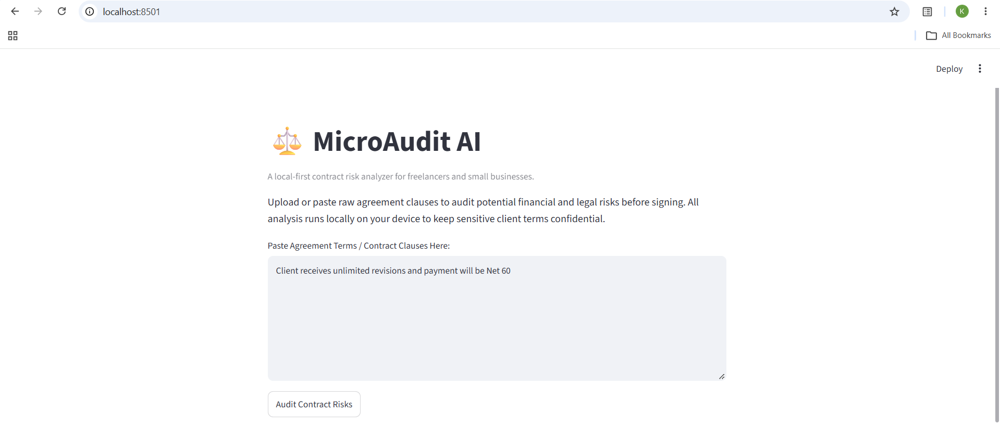
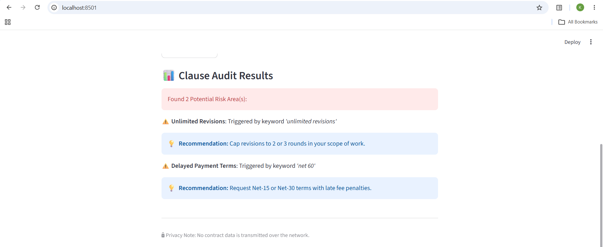

# ⚖️ MicroAudit AI — Local Freelance Contract Risk Analyzer

**MicroAudit AI** is a lightweight, local-first web application designed for freelancers, independent contractors, and small business owners to quickly audit client agreements for high-risk clauses (such as delayed payment terms, IP traps, and unlimited revisions) before signing.

---

## 📸 Application Screenshots

> *Scans contract text locally, flags high-risk clauses, and provides actionable negotiation recommendations:*





---

## 🚀 Key Features

- **Automated Risk Detection:** Scans raw agreement text for dangerous legal patterns including Net 60/90 payment terms, broad indemnification, and unlimited revisions.
- **Actionable Advice:** Offers clear recommendations and safer contract phrasing for every identified risk.
- **100% Privacy-First:** All text processing runs completely locally on the client machine. Client names, payment rates, and sensitive non-disclosure agreements (NDAs) never touch external cloud servers.
- **Zero Operating Cost:** Runs locally using Python and Streamlit with no external API fees or token usage billing.

---

## 🛠️ Tech Stack

- **UI Framework:** Streamlit (Python)
- **Execution Engine:** Local Client-Side Python Runtime

---

## 💻 Step-by-Step Local Setup & Execution

Follow these exact steps to clone and run the application locally on your machine:

### Prerequisites
- **Python 3.8 or higher** installed on your system.

### 1. Clone the Repository
Open your terminal or Git Bash and clone the project repository:
```bash
git clone https://github.com/kalyanvoleti/microaudit-ai.git
cd microaudit-ai

```

### 2. Set Up a Virtual Environment (Recommended)

Creating an isolated virtual environment prevents library conflicts:

* **On Windows (Git Bash):**
```bash
python -m venv venv
source venv/Scripts/activate

```


* **On macOS / Linux:**
```bash
python3 -m venv venv
source venv/bin/activate

```


### 3. Install Required Dependencies

Install Streamlit using pip:

```bash
pip install streamlit

```

### 4. Run the Application

Launch the local web server:

```bash
streamlit run app.py

```

After running the command, your browser will automatically open the application at `http://localhost:8501`.

---

## 📄 Usage Example

1. Paste sample contract text into the input box (e.g., `"Client receives unlimited revisions and payment will be Net 60."`).
2. Click **Audit Contract Risks**.
3. View the flagged risk categories and recommended contract adjustments.

---

## 🔒 Privacy Notice

This application operates entirely offline on your local host. No contract data, metrics, or personal inputs are transmitted across any network.